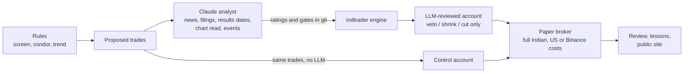

<div align="center">

# LLMTrading

**An open, measured experiment: does an LLM analyst make a rule-based trading strategy better?**

Fixed rules pick the trades on four paper-money desks: India stocks, US stocks, Nifty options and crypto. Claude reviews
them and can only veto, shrink or cut risk, never add it. A control account trades the same rules without the
LLM, so the LLM's value is measured, not assumed. Every decision is published.

[](https://github.com/DharmikGohil/LLMTrading/actions/workflows/ci.yml)
[](LICENSE)
[](pyproject.toml)
[](https://llmtrading.dharmikgohil.in)

[Live site](https://llmtrading.dharmikgohil.in) ·
[Architecture](docs/architecture.md) ·
[Strategy](docs/strategy.md) ·
[Operations](docs/operations.md) ·
[CLI](docs/cli.md) ·
[Research](docs/research.md)

</div>

> [!WARNING]
> Research software, not investment advice. Everything here trades paper money. LLM ratings are non-deterministic
> and unproven as an edge, and SEBI found that over 91% of individual F&O traders lost money in FY25. Backtest,
> paper trade for months, and only then risk money you can afford to lose.

## The four desks

| Desk | Capital (paper) | Rules | What the LLM may do | Benchmark |
|---|---|---|---|---|
| **India stocks** | ₹1,00,000 | Nifty 200 momentum + SEPA trend template, 10 slots, 4× ATR stops | Veto or shrink a buy | Nifty 50, and the LLM-off control |
| **US stocks** | $10,000 | S&P 100, same method | Veto or shrink a buy | S&P 500, and the LLM-off control |
| **Nifty options** | ₹1,00,000 × 2, plus ₹1,000 | Weekly iron condors (defined risk); a ₹1,000 option-buying test | Event gate: widen strikes or skip a week | Rules-only condor account |
| **Crypto** | $10,000 USDT × 3 | BTC and ETH, each held while above its 50-day average, rebalanced daily | Cut exposure or exclude a coin | Rules-only account and BTC buy and hold |

**The LLM can only make things safer.** It never adds a trade or raises risk. Every rule was backtested before it went
live; the honest results are below.

## How it works



**Scheduled runs.** Scheduled Claude sessions on a Claude plan do the analysis (no API key), following written
playbooks in [`analyst/`](analyst). The crypto desk runs 24/7 on GitHub Actions.

| Time | Desk | Run |
|---|---|---|
| 05:05 IST | Crypto | Claude's risk gate for the day ([playbook](analyst/CRYPTO_PLAYBOOK.md)) |
| 05:40 IST, then every 2 h | Crypto | Daily rebalance check; gate and equity checks (GitHub Actions) |
| 07:40 IST | India | Analyst reviews the screen's candidates and writes sourced ratings, a chart read and a bear case |
| 09:16 · 12:35 · 15:05 IST | India + options | Trade · monitor · close (equity, graded review, lessons); options gate and condor entries |
| Market hours | Options | One-minute exit monitor for the condors and the ₹1,000 test |
| 09:50 · 12:50 · 15:45 ET | US | Review and trade · monitor · close |

Details: [operations](docs/operations.md).

**Safety by design.** An own cash ledger, pending-order tracking, partial fills, stops that only move up, a daily
loss kill switch and a file-based halt. Indian costs are modelled in full: STT, stamp duty, exchange, SEBI, GST and
DP charges, NSE tick bands and holidays, ASM/GSM surveillance lists, results blackouts and corporate actions.

**Learns in public.** Every close writes a graded review. Patterns become lessons only after three supporting cases,
and every analyst run reads the lesson book first.

## The website

[llmtrading.dharmikgohil.in](https://llmtrading.dharmikgohil.in) (Next.js on Vercel, in [`web/`](web/README.md)):

- **Home:** one card per desk with value, return, benchmark, the LLM-vs-control gap and a trend line.
- **Portfolio:** a broker-style view of every account: funds, holdings at live prices, orders and F&O positions.
- **Desks:** India stocks, US stocks, Nifty options and crypto, each with four key numbers, an equity chart against
  its benchmark, and tabs for positions, decisions, orders, calls and history.
- **Activity:** the full log of calls, orders and vetoes, the daily ledger and every analyst call with its sources.
- **Journal:** daily reviews, the lesson book and the research behind the design.
- **Stock pages:** a candlestick chart with EMA 20/50, SMA 200, Bollinger bands, support and resistance, volume, RSI
  and MACD, plus a plain-language chart read ([how it reads a chart](docs/technical-analysis.md)).

Stock and index prices update about every 15 seconds while markets are open, and crypto prices every 10 seconds.
The look is light and calm by default: a lavender-grey page, white rounded cards, one violet accent (violet lines are
the LLM-reviewed accounts, pink lines the rules-only controls, grey dashed lines the benchmarks), soft green and red
pills for changes, and Plus Jakarta Sans with tabular figures. There is a matching dark theme and a bottom tab bar on
phones.

## Results so far

Each idea was tested with costs, and where possible on data the rule was not designed on. So far none beats simply
holding the index (or BTC) after costs and tax:

| Study | Finding |
|---|---|
| [Stock momentum](docs/backtest-forensics.md) | +18.5% vs the Nifty 50's +15.1% (Jan 2024 to Nov 2026), but +12.5% to +13.4% once survivorship, realistic costs or one-day-late execution are fixed: it trails the index |
| [Nifty options](docs/options-backtest.md) | 46 of 48 weekly iron condor variants lost money, 2020-2026; the ₹1,000 option-buying rule lost 11-20% of everything staked |
| [Crypto](docs/crypto-desk.md) | Altcoin momentum fell apart out of sample. BTC + ETH 50-day trend roughly matched BTC buy and hold (+384% vs +350%, 2023-26) with about half the drawdown (−31% vs −53%), but after Indian crypto tax buy and hold still wins |
| [OI build-up board](docs/oi-buildup.md) | Trading it lost about −43% over four years after costs |
| [Kronos forecasts](docs/kronos.md) | Its 80% price bands held only 46% of outcomes; its odds scored worse than the base rate |
| [Technical analysis](docs/technical-analysis.md) | RSI, MACD, Bollinger and candle rules mostly do not beat buy and hold after costs; they are used as reading aids |

The LLM layer cannot be backtested honestly (models have seen the past), so it is judged only on forward paper
trading against its control account. Live numbers are on the [site](https://llmtrading.dharmikgohil.in).

## Quick start

```bash
git clone https://github.com/DharmikGohil/LLMTrading && cd LLMTrading
python -m venv .venv && source .venv/bin/activate        # Python 3.11+
pip install -e ".[dev]"
make test                                                 # 98 offline tests, no network or LLM

cp config/config.example.yaml config/config.yaml
indtrader screen                    # today's momentum candidates
indtrader brief RELIANCE,TCS        # fact sheet: technicals, chart read, NSE filings, results dates
indtrader costs 2500 40             # round-trip charges and break-even move
indtrader backtest --start 2024-01-01
indtrader crypto-status             # the crypto desk's accounts
```

The site: `cd web && npm ci && npm run dev`. Every command: [CLI reference](docs/cli.md).

## Repository layout

```
indtrader/        Python package: engine, strategy, risk, costs, screen, chart reading, options, crypto, brokers, CLI
tests/            Offline test suite (pytest)
config/           Desk configurations (India paper, US paper, analyst, example)
analyst/          Playbooks the scheduled Claude sessions follow (stocks, desk, options, crypto)
signals*/         Analyst ratings and sourced reports, one folder per day
paper/            Paper account state for every desk, including options and crypto (committed by each run)
journal/          Daily graded reviews, lesson book, strategy change log
public/           Exported desk data (JSON) for the site
web/              Next.js site, deployed on Vercel
scripts/          Studies and backtests, data downloads, dashboard export, the options live monitor
.github/          CI and the 24/7 crypto desk workflow
.claude/skills/   Project skills: SEC filings, news, scanners (from day-trader-skill, MIT)
docs/             Architecture, strategy, operations, CLI, research and every study
```

## Documentation

| Guide | What it covers |
|---|---|
| [Architecture](docs/architecture.md) | Modules, data flow, safety design, the site |
| [Strategy](docs/strategy.md) | Screen, hybrid veto, sizing, stops, regime filter, backtests, learning loop |
| [Operations](docs/operations.md) | Scheduled desks, playbooks, state in git, running your own desk |
| [CLI reference](docs/cli.md) | Every `indtrader` command |
| [Going live](docs/live-trading.md) | Brokers, data sources, SEBI algo rules, a checklist before real money |
| [Research](docs/research.md) | The evidence behind the design, and the projects it borrows from |
| [Technical analysis](docs/technical-analysis.md) | How the desk reads a chart (EMA, RSI, MACD, Bollinger, levels, candles) and what the evidence says |
| [Crypto desk](docs/crypto-desk.md) | How the crypto strategy was chosen (design vs test period) and how the 24/7 desk runs |
| [Crypto backtest](docs/crypto-backtest.md) | BTC trend and altcoin momentum vs buy and hold, 2020-2026, with Indian crypto tax |
| [Options backtest](docs/options-backtest.md) | Nifty, Bank Nifty and Fin Nifty iron condors and option buying, 2020-2026 |
| [Backtest forensics](docs/backtest-forensics.md) | Survivorship, costs and timing audit of the momentum backtest |
| [OI build-up test](docs/oi-buildup.md) | Does the F&O open-interest build-up predict returns? 2023-2026 |
| [Kronos test](docs/kronos.md) | Walk-forward check of the Kronos candlestick model on Nifty, stocks and SPY |
| [Audit](docs/audit.md) | What was taken from each borrowed project, what was left out, and why |
| [Roadmap](docs/roadmap.md) | What comes next |

## Contributing

Issues and suggestions are welcome. Please read [CONTRIBUTING.md](CONTRIBUTING.md) and the
[Code of Conduct](CODE_OF_CONDUCT.md). Security issues: see [SECURITY.md](SECURITY.md).

## License

Copyright © 2026 Dharmik Gohil. **All rights reserved.** The code is public to read and audit, not to
reuse: see [LICENSE](LICENSE). Bundled third-party skills keep their own MIT licence
([`.claude/skills/LICENSE-day-trader-skill`](.claude/skills/LICENSE-day-trader-skill)).

## Acknowledgements

[TradingAgents](https://github.com/TauricResearch/TradingAgents) ·
[Vibe-Trading](https://github.com/HKUDS/Vibe-Trading) ·
[ai-hedge-fund](https://github.com/virattt/ai-hedge-fund) ·
[finance-skills](https://github.com/himself65/finance-skills) ·
[day-trader-skill](https://github.com/Jakeschincariol/day-trader-skill) ·
[OpenAlgo](https://github.com/marketcalls/openalgo) ·
[pykiteconnect](https://github.com/zerodha/pykiteconnect)
