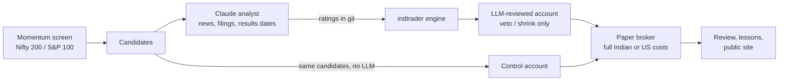

<div align="center">

# LLMTrading

**An open, measured experiment: does an LLM analyst make a rule-based trading strategy better?**

Momentum screens pick NSE and US stocks. Claude reviews every candidate for red flags and can only veto or
shrink a buy. A control account trades the same screen without the LLM, so the LLM's value is measured,
not assumed. Everything runs in paper mode, and every decision is published.

[](https://github.com/DharmikGohil/LLMTrading/actions/workflows/ci.yml)
[](LICENSE)
[](pyproject.toml)
[](https://llmtrading.dharmikgohil.in)

[Live desk](https://llmtrading.dharmikgohil.in) ·
[Architecture](docs/architecture.md) ·
[Strategy](docs/strategy.md) ·
[Operations](docs/operations.md) ·
[CLI](docs/cli.md) ·
[Going live](docs/live-trading.md) ·
[Research](docs/research.md)

</div>

> [!WARNING]
> Research software, not investment advice. LLM ratings are non-deterministic and unproven as an edge, and
> SEBI found that over 91% of individual F&O traders lost money in FY25. The desks trade paper money.
> Backtest, paper trade for months, and only then risk money you can afford to lose.

## Highlights

- **Two desks, one method.** India (Nifty 200, ₹10 lakh) by day and US (S&P 100, $10,000) by night, each
  with an LLM-reviewed account and an "LLM off" control account.
- **The LLM can only make things safer.** A momentum + low-volatility + trend screen proposes buys; the
  analyst's Underweight/Sell vetoes them and Hold shrinks them. It can never add a stock or raise risk.
- **No API key.** Scheduled Claude sessions do the analysis on a Claude plan, following written playbooks.
  TradingAgents and Vibe-Trading remain available as API-key alternatives.
- **Indian market details done properly.** Every statutory charge (STT, stamp duty, exchange, SEBI, GST,
  DP), NSE tick bands and holidays, ASM/GSM surveillance lists, results blackouts from NSE board-meeting
  data, split and bonus adjustments, a bear-regime filter.
- **Safety by design.** An own cash ledger, pending-order tracking, partial fills, stops that only move up,
  a daily loss kill switch and a file-based halt.
- **Learns in public.** Every close writes a graded review; patterns become lessons only after three
  supporting cases. All of it is on the [live desk](https://llmtrading.dharmikgohil.in).

## How it works



| Time (IST) | Desk | Run |
|---|---|---|
| 07:40 | India | Analyst reviews the screen's candidates and writes sourced ratings |
| 09:35 · 12:35 · 15:05 | India | Trade · monitor stops · close (equity, graded review, lessons) |
| 19:20 · 22:20 · 01:15 | US | Review and trade · monitor · close |

The scheduled runs are currently paused while the next phase (a Nifty options desk) is designed.
Details: [operations](docs/operations.md).

## Quick start

```bash
git clone https://github.com/DharmikGohil/LLMTrading && cd LLMTrading
python -m venv .venv && source .venv/bin/activate        # Python 3.11+
pip install -e ".[dev]"                                   # includes TradingAgents v0.7.1
make test                                                 # 66 offline tests, no network or LLM

cp config/config.example.yaml config/config.yaml
indtrader screen                    # today's momentum candidates
indtrader brief RELIANCE,TCS        # fact sheet: technicals, NSE filings, results dates
indtrader costs 2500 40             # round-trip charges and break-even move
indtrader backtest --start 2024-01-01
```

The public site lives in [`web/`](web/README.md): `cd web && npm ci && npm run dev`.

## Results so far

Backtest of the current default (slow momentum book with the SEPA trend template), Nifty 200,
January 2024 to October 2026, Indian costs: **+10.2%** against the Nifty 50's **+4.6%**, with a −20%
maximum drawdown. Today's index members are used, so survivorship bias flatters this, and the Sharpe
confidence interval crosses zero: there is no proven edge yet. The LLM layer cannot be backtested honestly
(models have seen the past), so it is judged only on forward paper trading against the control account.
Live numbers: [llmtrading.dharmikgohil.in](https://llmtrading.dharmikgohil.in).

## Repository layout

```
indtrader/        Python package: engine, strategy, risk, costs, screen, NSE data, brokers, CLI
tests/            Offline test suite (pytest)
config/           Desk configurations (India paper, US paper, analyst, example)
analyst/          Playbooks the scheduled Claude sessions follow
signals*/         Analyst ratings and sourced reports, one folder per day
paper/            Paper account state for each desk (committed by every run)
journal/          Daily graded reviews, lesson book, strategy change log
public/           Exported desk data (JSON) for the site
web/              Next.js site, deployed on Vercel
scripts/          Dashboard export and setup helpers
.claude/skills/   Project skills: SEC filings, news, scanners (from day-trader-skill, MIT)
docs/             Architecture, strategy, operations, CLI, live trading, research
```

## Documentation

| Guide | What it covers |
|---|---|
| [Architecture](docs/architecture.md) | Modules, data flow, safety design, the site |
| [Strategy](docs/strategy.md) | Screen, hybrid veto, sizing, stops, regime filter, backtests, learning loop |
| [Operations](docs/operations.md) | Scheduled desks, playbooks, state in git, running your own desk |
| [CLI reference](docs/cli.md) | Every `indtrader` command |
| [Going live](docs/live-trading.md) | Brokers, data sources, SEBI algo rules, a checklist before real money |
| [Research](docs/research.md) | The evidence behind the design, and the projects it borrows from |
| [Audit](docs/audit.md) | What was taken from each project, what was left out, and why |
| [Roadmap](docs/roadmap.md) | What comes next |

## Contributing

Issues and suggestions are welcome. Please read [CONTRIBUTING.md](CONTRIBUTING.md) and the
[Code of Conduct](CODE_OF_CONDUCT.md). Security issues: see [SECURITY.md](SECURITY.md).

## License

Copyright © 2026 Dharmik Gohil. **All rights reserved.** The code is public to read and audit, not to
reuse: see [LICENSE](LICENSE). Bundled third-party skills keep their own MIT licence
([`.claude/skills/LICENSE-day-trader-skill`](.claude/skills/LICENSE-day-trader-skill)).

## Acknowledgements

[TradingAgents](https://github.com/TauricResearch/TradingAgents) ·
[Vibe-Trading](https://github.com/HKUDS/Vibe-Trading) ·
[ai-hedge-fund](https://github.com/virattt/ai-hedge-fund) ·
[finance-skills](https://github.com/himself65/finance-skills) ·
[day-trader-skill](https://github.com/Jakeschincariol/day-trader-skill) ·
[OpenAlgo](https://github.com/marketcalls/openalgo) ·
[pykiteconnect](https://github.com/zerodha/pykiteconnect)
