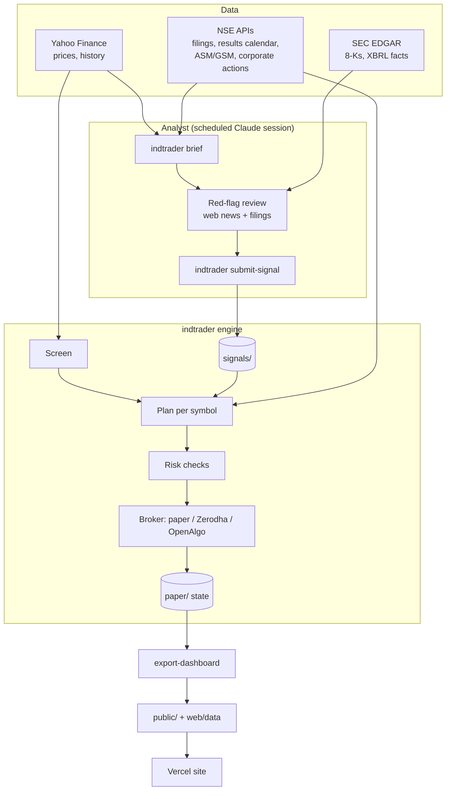

# Architecture

LLMTrading is a Python package (`indtrader`), a set of playbooks that scheduled Claude sessions follow, and a
static Next.js site. State lives in git, so any run can start in a fresh container.

## Modules

| Module | Responsibility |
|---|---|
| `indtrader/config.py` | Typed settings (pydantic): LLM, strategy, risk, broker, schedule, screen, second opinion |
| `indtrader/market.py` | Exchange calendars (NSE and US), session times, holidays, tick sizes, closing auction session |
| `indtrader/data.py` | Price history and quotes (Yahoo), cleaned of bad bars |
| `indtrader/screen.py` | Momentum (6 and 12 months, risk-adjusted, skip last month) + low-volatility + liquidity + 200-DMA trend screen, optional SEPA trend template |
| `indtrader/strategy.py` | Rating to target quantity: allocation and risk-to-stop sizing, ATR stops, bear-regime scaling, `combine_opinions` |
| `indtrader/risk.py` | Daily loss kill switch, position and exposure caps, sector cap, cash, order count, min order value, price-ran-away guard |
| `indtrader/costs.py` | STT, exchange transaction charges, SEBI fee, stamp duty, GST, DP charge, brokerage; US SEC fee and FINRA TAF |
| `indtrader/nse.py` | NSE data: surveillance lists, security series and price bands, event calendar plus per-symbol board meetings, corporate actions, announcements |
| `indtrader/engine.py` | Orchestration: own cash ledger, pending orders, partial fills, unknown placements, corporate actions, decisions log, equity records, shadow arms |
| `indtrader/scheduler.py` | Daily loop with per-step error handling, background analysis, persisted progress |
| `indtrader/signals/` | Rating sources: TradingAgents wrapper (`llm_agent.py`), external ratings store, Vibe-Trading second opinion |
| `indtrader/brokers/` | `paper` (simulated fills with costs), `zerodha` (Kite Connect), `openalgo` (25+ Indian brokers) |
| `indtrader/backtest.py`, `validation.py` | Daily portfolio backtest with the live sizing and risk code; block-bootstrap Sharpe CI and walk-forward windows |
| `indtrader/journal.py`, `scorecard.py` | Graded daily review, lesson book, rating scorecard |
| `indtrader/export.py` | JSON export of accounts, positions, trades, decisions, calls and equity for the site |
| `indtrader/cli.py` | The `indtrader` command (see [CLI reference](cli.md)) |

## Accounts and arms

Each desk keeps a **main** account (LLM-reviewed, `signal_mode: hybrid`) and one or more **shadow arms**
(`shadow_arms: [factor]`): paper accounts that take the same screen without the LLM. The engine trades all of
them in one run with identical sizing, risk limits and costs, so the only difference is the LLM review.

## Safety design

- **Own shares only.** The bot sells only shares it bought (tracked in `bot_state.json`), so long-term
  holdings in the same demat account are never touched.
- **Own cash ledger.** Capital plus realised P&L minus open positions and charges. The bot never spends more
  than its capital (plus profits), and the daily loss kill switch sees its real P&L.
- **Pending orders.** No second order while one is working for the same stock. Partial fills are tracked;
  an order whose placement timed out is looked up in the broker's order book before anything else happens.
- **Orders.** Marketable LIMIT orders on NSE's price-band tick grid, never naked market orders. Stops only
  move up. `--dry-run` everywhere, and `indtrader halt` blocks all orders until `indtrader resume`.
- **Scheduler.** Each step has its own error handling; analysis runs in the background so stop monitoring
  never pauses; progress is saved so a restart never repeats the day's trades.

## Site

`web/` is a static Next.js 15 app (App Router). `scripts/refresh_dashboard.sh` exports both desks to
`public/*.json` and copies them, with the journal and reports, into `web/data/`. Every push to `main`
redeploys it on Vercel. A single dynamic route, `/api/quotes`, proxies live quotes for open positions and
both indices (CDN-cached for 10 seconds), so the browser can show live P&L between runs. See
[web/README.md](../web/README.md).
